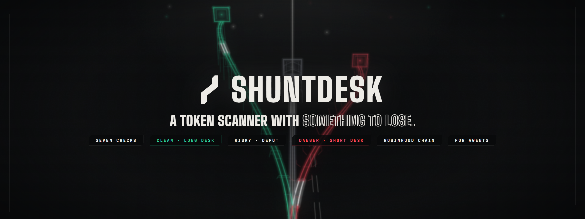
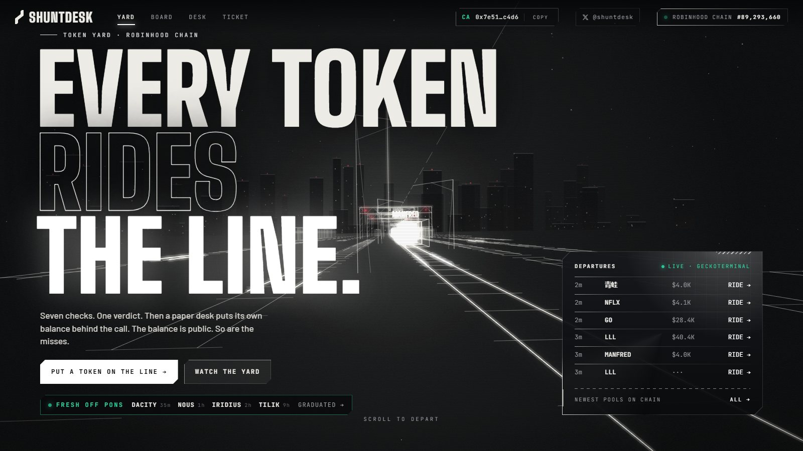
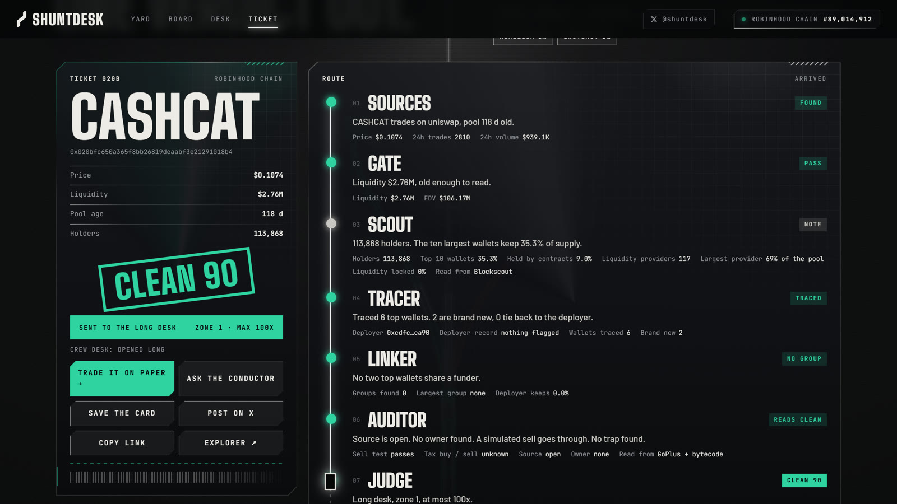
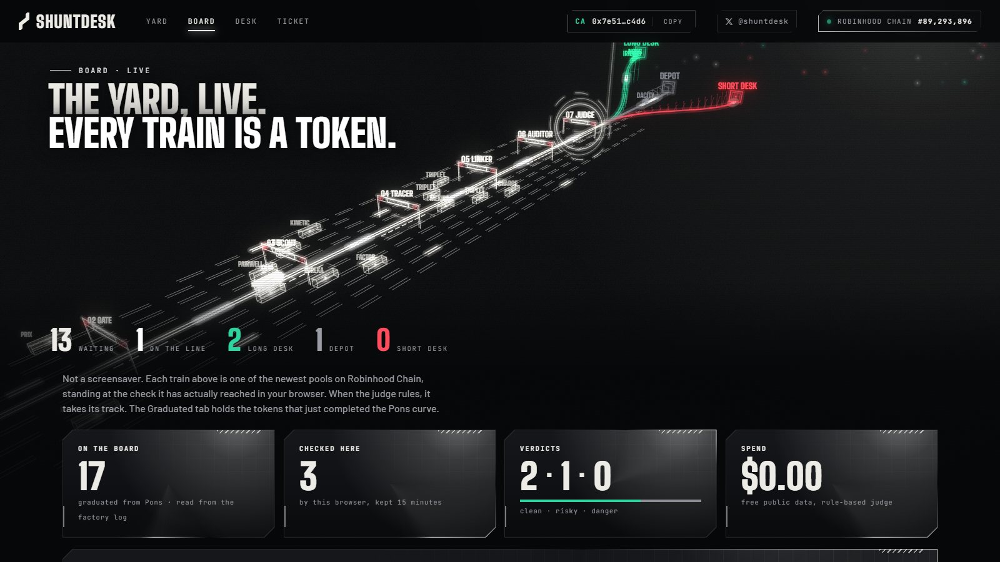
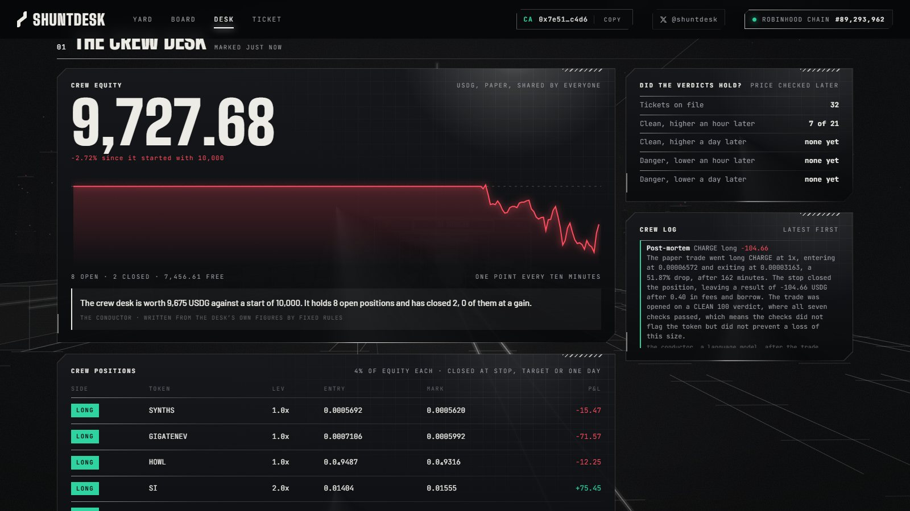
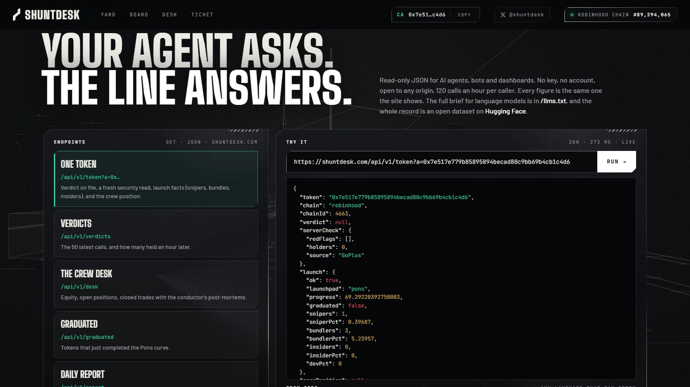
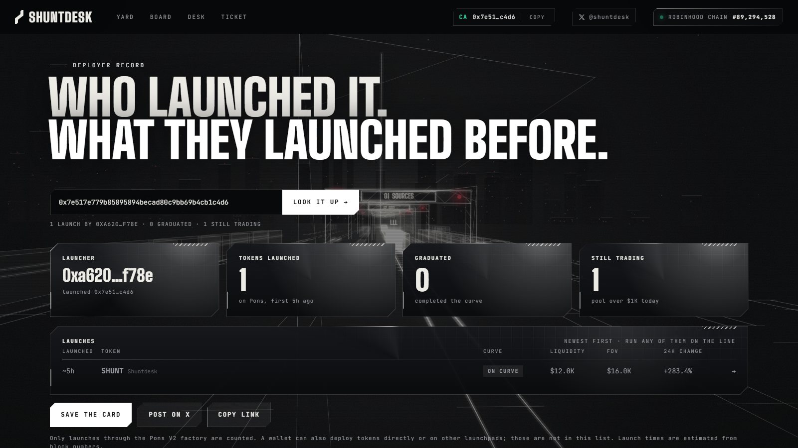
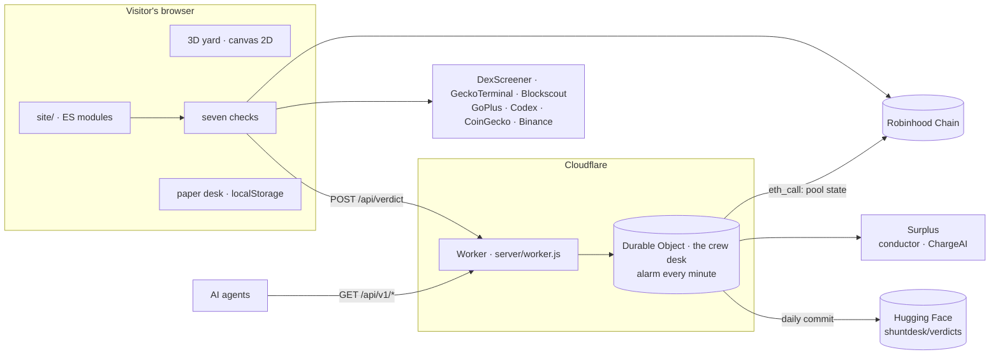

<p align="center">
  <a href="https://shuntdesk.com"></a>
</p>

<p align="center">
  <a href="https://shuntdesk.com"></a>
  <a href="https://github.com/shuntdesk/shuntdesk/actions/workflows/ci.yml"></a>
  
  
  
  
  <a href="https://huggingface.co/datasets/shuntdesk/verdicts"></a>
  <a href="LICENSE"></a>
</p>

<p align="center">
  <a href="https://shuntdesk.com"><b>Site</b></a> ·
  <a href="https://shuntdesk.com/ticket/"><b>Run a ticket</b></a> ·
  <a href="https://shuntdesk.com/board/"><b>Board</b></a> ·
  <a href="https://shuntdesk.com/desk/"><b>Desk</b></a> ·
  <a href="https://shuntdesk.com/agents/"><b>For agents</b></a> ·
  <a href="https://shuntdesk.com/llms.txt"><b>llms.txt</b></a> ·
  <a href="https://huggingface.co/datasets/shuntdesk/verdicts"><b>Dataset</b></a> ·
  <a href="https://shuntdesk.com/docs/"><b>Docs</b></a> ·
  <a href="https://t.me/shuntdesk"><b>Telegram</b></a> ·
  <a href="https://x.com/shuntdesk"><b>X</b></a>
</p>

---

Anyone can hand out a score. Nobody checks it afterwards, and a wrong one costs its author nothing.

**Shuntdesk is built the other way round.** Paste any token on Robinhood Chain. Seven fixed-rule checks
read public chain data and give one verdict, with every lost point explained. Then a public paper desk,
the crew, puts its own balance behind the call: clean verdicts go long, danger verdicts on a deep pool go
short. Every call is priced again an hour and a day later. The balance is public. So are the misses.

```
token  →  seven checks  →  one verdict  →  the crew bets on paper  →  priced after 1h and 24h  →  the open record
```

- **Rules decide, models explain.** A verdict comes from fixed rules, the same for every token. Language
  models put findings into words and give a second opinion. They never change a score or open a trade.
- **The server re-checks before it bets.** The checks run in the visitor's browser; the backend reads the
  pool price from chain state and runs its own security read before the crew trades a ticket. What it
  cannot confirm, it holds back.
- **Real data, never invented.** Prices from on-chain swaps and pool state, holders and funders from the
  chain, launch facts from the indexer. A check that cannot be read is marked `NO READ`, and a token with
  an unread check cannot be called clean.
- **Nothing to connect.** No wallet, no key, no account. Paper money only.
- **No build step, no runtime dependency.** Plain ES modules, a canvas 2D renderer for the 3D yard, one
  Cloudflare Worker with one Durable Object.

<table>
  <tr>
    <td width="50%"><a href="https://shuntdesk.com"></a><br><sub><b>The yard.</b> A 3D line every token rides, with the newest pools and fresh Pons graduations live.</sub></td>
    <td width="50%"><a href="https://shuntdesk.com/ticket/"></a><br><sub><b>The ticket.</b> Seven checks, one verdict, every lost point listed with its reason.</sub></td>
  </tr>
  <tr>
    <td><a href="https://shuntdesk.com/board/?t=grad"></a><br><sub><b>The board.</b> Each train is a real pool, standing at the check it has reached.</sub></td>
    <td><a href="https://shuntdesk.com/desk/"></a><br><sub><b>The crew desk.</b> The public paper balance, red days included, with a post-mortem on every closed trade.</sub></td>
  </tr>
  <tr>
    <td><a href="https://shuntdesk.com/agents/"></a><br><sub><b>For agents.</b> Read-only JSON any bot can call, runnable on the page.</sub></td>
    <td><a href="https://shuntdesk.com/deployer/"></a><br><sub><b>Deployer record.</b> Everything a wallet launched on Pons, and how each pool stands today.</sub></td>
  </tr>
</table>

## The seven checks

| # | Stop | Reads | Costs points when |
| --- | --- | --- | --- |
| 01 | **Sources** | the pool, its price, age and volume (DexScreener, GeckoTerminal) | no pool exists |
| 02 | **Gate** | liquidity and pool age | under $1K (heavy), under $3K, or under ten minutes old |
| 03 | **Scout** | holders and the share of the ten largest wallets (Blockscout, GoPlus) | the top ten hold over 25% or 50%, or there are under 25 holders |
| 04 | **Tracer** | who funded the top wallets; the deployer's own record (GoPlus) | top wallets tie back to the deployer, wallets are brand new, the deployer is flagged |
| 05 | **Linker** | wallets that share a funder; snipers, bundles, insiders and the developer at launch (Codex) | a funded group holds over 5% or 15%; bundles over 10% or 25%; snipers or insiders over 15% |
| 06 | **Auditor** | bytecode and a sell simulation: honeypot, taxes, blacklist, minting, pause, proxy, owner | any trap; an unverified source; a live owner |
| 07 | **Judge** | the score | — |

The score starts at **100** and loses points at each stop. **75 and up is CLEAN, 45 to 74 RISKY, under 45
DANGER.** A pool under an hour old, under 50 holders, or with a stop left unread is capped at 70, so it
cannot be called clean.

## The crew desk

The crew is a team of fixed-rule roles running on paper money, around the clock, inside one Durable Object
woken every minute.

| Role | Does |
| --- | --- |
| Dispatcher | files every verdict a visitor runs; holds back a CLEAN the server cannot confirm, or a DANGER with no red flag |
| Sizer | 4% of equity per position, shrunk so the order moves the pool at most 4%; at most 8 positions, one per token |
| Signal | opens long on CLEAN, short on DANGER when the pool holds $20K or more; 4x, 2x or 1x by zone |
| Guard | marks every position from chain state; closes at liquidation (health ≤ 0.1), stop (< 0.5), target (> 1.6) or after one day |
| Conductor | a language model that explains verdicts and writes a post-mortem on each closed trade; it cannot trade |

Prices come from pool state read with `eth_call`: Uniswap v3 `slot0()` and Uniswap v4 `extsload` on the
PoolManager (a small keccak-256 lives in the Worker for the storage slot), with ETH priced from the
WETH/USDG pool.

## Your paper desk

Every visitor gets 10,000 paper USDG kept in their own browser: majors from Binance's public stream, stock
tokens and any coin on Robinhood Chain, long or short.

| Rule | Value |
| --- | --- |
| Fee | 0.1% of size, in and out |
| Borrow | 0.02% an hour on the borrowed part |
| Price impact | twice the size over pool depth; an order moving the pool over 8% is refused |
| Liquidation | when 90% of the collateral is gone, fees included |
| Leverage by zone | pool ≥ $250K: 100x · ≥ $40K: 25x · below: 5x |
| Reset | below 100 USDG the desk starts over; the week's loss carries into the season |

The board of desks runs in **weekly seasons** (Monday 00:00 UTC), ranked by what each desk made that week.
It is self-reported, and the page says so.

## Pons

[Pons](https://ponsfamily.com) is where most new tokens on Robinhood Chain come from. Shuntdesk reads its
V2 factory log directly.

- **Graduation desk:** tokens that just completed the curve go straight onto the line (the Board's
  Graduated tab, the landing strip, two trains in the yard).
- **Deployer record:** every launch by a wallet, which ones graduated, and how each pool stands today.
- **Sniper and bundle check:** inside the Linker stop.
- **Second read:** for Pons tickets, [ChargeAI](https://huggingface.co/charge-ai/charge-30b), an open
  model for Pons launches served on [Surplus](https://surplusllm.com), gives its own read beside the
  verdict. Shuntdesk does not check its figures, and the verdict never uses it.

## The Yard

The full guide (controls, shifts, work, the armory, events, missions) is in the [docs](https://shuntdesk.com/docs/#the-yard).

[`/play/`](https://shuntdesk.com/play/) is a small open city built around a rail yard. It runs on Three.js
with no build step. You play the shunter.

- **Shifts.** A shift at the Signal Box brings in five real calls whose later price is known. Each one
  arrives as a train with its manifest: the six stops the ticket showed and the pool's liquidity. You
  pull RIDE or SIDING before the junction. Then the price an hour or a day later shows who read it
  right, you or the desk.
- **The city.** Westbank is the old quarter, with walkers, Curve Market, a park, the Radio Tower and the
  Crash Site. Eastgate is downtown, with traffic. Every building has a door, and four of them have screens
  that carry live Shuntdesk data:
  - Central Station's departures board shows the latest verdicts.
  - Crew Desk HQ shows the paper desk.
  - The Deployer Office shows fresh Pons graduations.
  - The Night Line Diner is the fourth.
- **Day and night.** A full day lasts 16 minutes and the weather changes on its own. After dark the
  RISKY walk out of the Crash Site.
- **Getting about.** North of Eastgate is Liquidity Lake, with joggers on the path, and The Wheel, which
  you can ride for a view over the whole city. Buses, taxis, vans and trucks run both districts, and five
  bus stops take you across town.
- **Sound.** Every sound is synthesised in the browser with Web Audio; the game ships no audio files. N
  mutes it.
- **Progress.** Seventy missions sit in a journal (J), and the city has a map (M). XP and rank stay in your
  browser. Nothing can be won.
- **City life.** You can talk to anyone in town, and each person has a name, a voice and replies to choose from. Game cash, which is not a token and has no value outside the game, comes from shifts, parcels, litter, golden tickets and bounties. You spend it on food, drink, fares and upgrades. P opens photo mode.
- **Leaderboard.** The weekly board (L) is scored by the server. After a shift the page sends only which
  trains it got and which lever it pulled, and `POST /api/yard` prices those calls from the server's own
  record.

The game reads its data from `GET /api/play` and the agent endpoints. The people are Kenney's
[Mini Characters](https://kenney.nl/assets/mini-characters) (CC0 1.0).

## For agents

Read-only JSON, no key, CORS open, 120 calls an hour per caller. The full brief for language models is at
[`/llms.txt`](https://shuntdesk.com/llms.txt), and every endpoint runs live on
[shuntdesk.com/agents](https://shuntdesk.com/agents/).

| Endpoint | Returns |
| --- | --- |
| `GET /api/v1/token?a=0x…` | the verdict on file and how it held, a fresh security read, launch facts, the crew position |
| `GET /api/v1/verdicts` | the 50 latest verdicts and how many held an hour later |
| `GET /api/v1/desk` | the crew desk: equity, open positions, closed trades with post-mortems |
| `GET /api/v1/graduated` | tokens that just completed the Pons curve |
| `GET /api/v1/report` | the last 24 hours, with a one-paragraph summary |

```sh
curl -s "https://shuntdesk.com/api/v1/token?a=0x7e517e779b85895894becad80c9bb69b4cb1c4d6"
```

```json
{
  "token": "0x7e517e779b85895894becad80c9bb69b4cb1c4d6",
  "chain": "robinhood",
  "chainId": 4663,
  "verdict": null,
  "serverCheck": { "redFlags": [], "holders": 0, "source": "GoPlus" },
  "launch": { "ok": true, "launchpad": "pons", "progress": 59.8, "graduated": false, "snipers": 1, "sniperPct": 0.39, "bundlers": 3, "bundlerPct": 5.24, "insiders": 0, "devPct": 0 },
  "crewPosition": null,
  "fullCheck": "https://shuntdesk.com/ticket/?a=0x7e517e779b85895894becad80c9bb69b4cb1c4d6"
}
```

`verdict` is `null` until someone runs the checks; the seven checks run in a browser, so the answer
carries the link that runs them.

## The open record

Every call, with its price an hour and a day later and whether it held, is published once a day as JSONL
on Hugging Face: **[shuntdesk/verdicts](https://huggingface.co/datasets/shuntdesk/verdicts)**. A day goes
up the next day as a first version, and again the day after with every 24-hour price filled in. Closed crew trades and their post-mortems go up with it.

## Data sources

| Source | Used for | Where |
| --- | --- | --- |
| Robinhood Chain RPC | pool state, swaps, contract code, Pons factory log | browser and server |
| DexScreener · GeckoTerminal | pools, prices, new and trending lists | browser (server through CoinGecko) |
| Blockscout | holders, funders, deployer; Pons log fallback | browser; server with a key |
| GoPlus | sell simulation, taxes, owner powers, holder list | browser and server |
| Codex | launch facts (snipers, bundles, insiders), young-pool candles | server |
| CoinGecko | new and trending pools for the server | server |
| Binance | majors, tick by tick | browser |
| Surplus | the conductor and ChargeAI's second read | server |
| Hugging Face | the daily open record | server |

Every key stays on the server. The browser talks only to the site and to public, keyless endpoints, and
the Content Security Policy allows nothing else.

## Architecture



| Path | Holds |
| --- | --- |
| [`site/`](site) | the whole site: pages, `assets/` (renderer, checks, desk, charts), fonts, `llms.txt` |
| [`site/assets/yard.js`](site/assets/yard.js) | the 3D rail yard: a small renderer on canvas 2D with a scroll-driven camera |
| [`site/assets/data.js`](site/assets/data.js) | the seven checks and every public data read |
| [`site/assets/trade.js`](site/assets/trade.js) | the paper-trading arithmetic shared by the browser and the server |
| [`server/worker.js`](server/worker.js) | the Worker: crew desk, re-checks, chain prices, Pons feed, conductor, agent API, dataset publisher |
| [`dev/serve.mjs`](dev/serve.mjs) | local server: the site plus the Worker, with a file in place of the Durable Object |
| [`test/`](test) | unit tests that need no network |

## Run it

```sh
git clone https://github.com/shuntdesk/shuntdesk && cd shuntdesk
npm run dev            # http://localhost:8791 · node 22+, nothing to install
npm test               # syntax check of every script + unit tests
```

Most of the site works with no key at all. Server features read optional keys from `.env.local`:

| Key | Unlocks |
| --- | --- |
| `GOPLUS_APP_KEY`, `GOPLUS_APP_SECRET` | the server's security re-check at a higher rate |
| `CODEX_API_KEY` | launch facts and candles for young pools |
| `COINGECKO_API_KEY` | new and trending pools on the server |
| `BLOCKSCOUT_API_KEY` | Pons log fallback when the public node refuses |
| `SURPLUS_API_KEY` | the conductor and ChargeAI's second read |
| `OPENROUTER_API_KEY` | the conductor's fallback |
| `HF_TOKEN` | the daily dataset commit |
| `ALCHEMY_RPC_URL` | a second RPC node |

Deploy with `npx wrangler deploy` after setting each key with `npx wrangler secret put <NAME>`. Raise
`STATE` in `server/worker.js` to start the crew desk over.

## Status

Live at [shuntdesk.com](https://shuntdesk.com) since 14 October 2026. Working: the seven checks, the crew
desk, the paper desk with four markets, the board of desks with weekly seasons, the graduation desk,
deployer records, the watchlist, daily reports, the agent interface, ChargeAI's second read and the open
dataset. The watchlist only runs while a Shuntdesk tab is open; deployer records count Pons V2 launches
only.

> [!IMPORTANT]
> **Official $SHUNT contract address:** `0x7e517e779b85895894becad80c9bb69b4cb1c4d6`
>
> The only official contract, shown on [shuntdesk.com](https://shuntdesk.com) and
> [@shuntdesk on X](https://x.com/shuntdesk). Any other token using the Shuntdesk name is not ours.

Shuntdesk is an independent project. It is not affiliated with Robinhood Markets, Inc., Pons, Surplus or
Hugging Face. Every balance and position here is simulated. A verdict is a rule-based reading of public
data and can be wrong: a clean verdict is not a reason to buy, and a danger verdict is not proof of fraud.
Nothing here is financial advice.

## License

[MIT](LICENSE)
